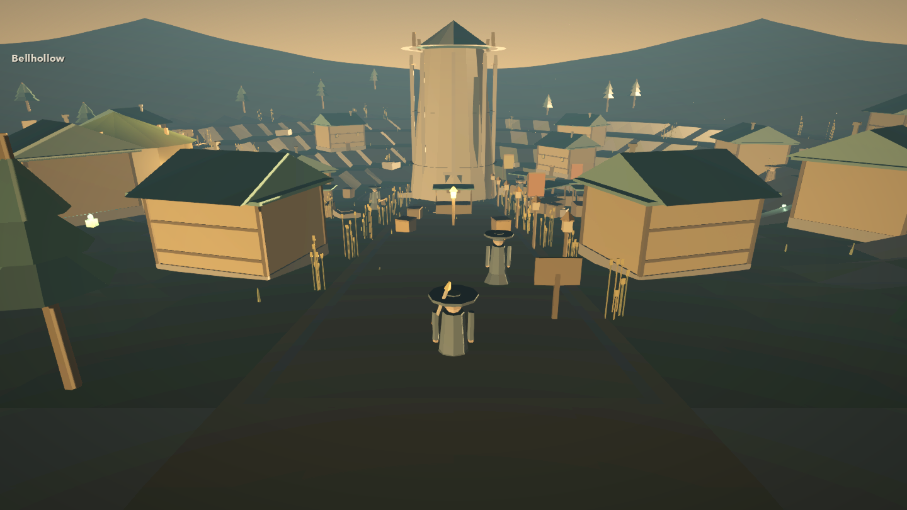
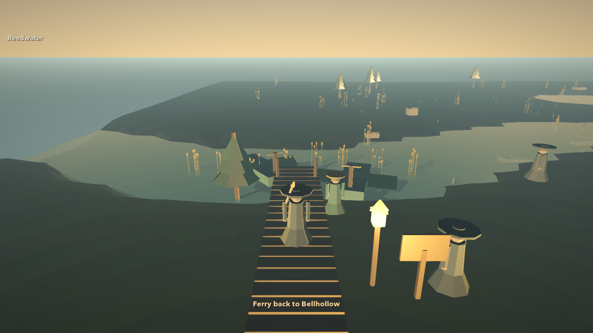
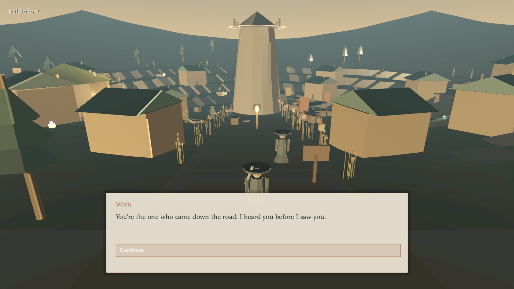

# The Long Note

*A valley kept alive by a song. A song made of people. A Listener who can hear the difference.*

**An original open-valley action adventure for macOS, Windows, and iPhone.**
Engine: Godot 4.7.2 · Language: GDScript · Status: playable vertical slice (0.1.1) · Offline, single-player, no notifications, no timers.
Repository: <https://github.com/leksarodic/the-long-note>






---

## Download

**Latest release:** <https://github.com/leksarodic/the-long-note/releases/latest>

- **Windows:** `TheLongNote-0.1.1-Windows.zip` — 64-bit Windows 10/11. Unzip anywhere and run `TheLongNote.exe`.
- **macOS:** `TheLongNote-0.1.1-macOS.dmg` (Apple Silicon and Intel, macOS 13+). The app is ad-hoc signed but not notarized, so macOS will ask you to confirm the first launch: right-click the app → **Open**, or run `xattr -dr com.apple.quarantine "/Applications/The Long Note.app"` once. A `.zip` of the app is also attached.
- **iPhone:** `TheLongNote-0.1.1-iOS-Xcode.zip` contains the generated Xcode project, PCK, and frameworks. It is **not** a signed IPA; building for a device requires your Apple team and provisioning profile. See [`docs/architecture/ios_build.md`](docs/architecture/ios_build.md).
- **Source:** the tagged source archive and the full repository are available from the release page.

The release is the same build covered by the test record below: 47 logic/save/sync checks, 49 integration checks, and a 36-check end-to-end playthrough.

---

## What this is

*The Long Note* is an original IP: a handcrafted valley of terraced cliffs, reed water, drowned shrines, and a town built inside a dry waterfall. For four hundred years the valley was held stable by a single sustained note, fed by voices taken from people who were told it was maintenance. Twelve years before the game begins, the note was broken open and the voices went home. The valley is now learning to sing for itself — badly, and in public.

You arrive as a new Listener: someone who can hear the undertone beneath the wind. You explore, gather, craft, build, fight dissonant creatures, solve harmonic and spatial puzzles, and decide what a community owes its dead.

This repository contains the **complete creative foundation** (novella, world bible, characters, factions, locations, timeline, structure), the **technical architecture**, and a **playable vertical slice** that covers the first two story chapters and a complete local arc with a consequential choice and an ending.

**The vertical slice includes:** the hub town of Bellhollow, the open Reedwater region, the Sunken Choir dungeon, four enemy archetypes, one boss with an observation puzzle, one AI companion, two side activities, a chord gate, a sluice puzzle, an echo-gallery puzzle, crafting, building, equipment, skills, a field-notebook UI, touch controls, and a tested atomic save/sync system.

**It does not include:** the full seven-chapter game, Glasswood, the Hush, the Low Water, the Quarry Door dungeon, co-op networking, voice acting, or a signed iPhone build. This README says exactly what is real.

---

## The story in one paragraph

Wren Alk returned to Carrow Vale to bury her father and found a town keeping a secret it had mistaken for a tradition. The Long Bell held a note that protected the valley, and the note was fed with voices — her brother's among them. With a reed-reader named Nissa, a grieving bell-founder, an archivist who knew too much, and a Warden who had done the arithmetic for thirty years, Wren went into the Hush to learn the chord her mother left behind. She came back and taught the town to sing it. The bell cracked. The voices went home. Sable lost her hearing. Wren stayed.

The complete novella (8,996 words, eight chapters) is in [`docs/story/novella.md`](docs/story/novella.md). It is a standalone read; the game is set twelve years later and does not retell it.

---

## Install

1. **Godot 4.7.2 stable** (standard build, not .NET): <https://godotengine.org/download>
   - Homebrew on macOS: `brew install --cask godot`
2. **Godot 4.7.2 export templates** (needed for macOS/iPhone builds):
   - In Godot: *Editor → Manage Export Templates → Download and Install*.
   - Or download `Godot_v4.7.2-stable_export_templates.tpz` and install it for version `4.7.2.stable`.
3. **Xcode 16 or newer** for the iPhone path (this machine used Xcode with iOS 27 SDK).
4. No other dependencies. No Python packages; the validator uses the standard library.

---

## Run on macOS

```sh
# from the repository root
godot --path game
```

Or open `game/project.godot` in the Godot editor and press Play.

Useful command-line modes used by the test/visual harness:

```sh
# Start directly in a region (skips the title screen)
godot --path game -- --world bellhollow
godot --path game -- --world reedwater --spawn dock
godot --path game -- --world sunken_choir --spawn entrance

# Capture a frame and quit
godot --path game --resolution 1440x810 -- --world bellhollow --capture /tmp/bellhollow.png

# Force the touch HUD on a Mac for layout review
godot --path game -- --world bellhollow --touch

# Open a screen or dialogue for visual review
godot --path game -- --world bellhollow --screen journal
godot --path game -- --world bellhollow --dialogue wren_arrival

# Performance sample on the real GPU
godot --path game -- --world bellhollow --benchmark
```

### Controls (macOS)

| Action | Keyboard / mouse | Gamepad |
|---|---|---|
| Move | WASD / arrows | Left stick |
| Camera | Middle-drag or Ctrl-drag | Right stick |
| Light attack | Left click or J | X |
| Heavy attack | Right click or K | Y |
| Dodge | Space | B |
| Interact | E | A |
| Listen | F | D-pad down |
| Ability 1 / 2 | Q / R | LB / RB |
| Sprint | Shift | L3 |
| Build mode | B | D-pad up |
| Pause / notebook | Esc | Start |
| Dialogue choices | 1–9, click, or focus + Enter | D-pad + A |

Touch: floating left stick, right-side camera drag, thumb-arc action cluster, menu pill. All targets are ≥ 64 dp and respect the display safe area.

---

## Run and build on Windows

Download the Windows ZIP, unzip it, and run `TheLongNote.exe`. No installer, account, or network is required. The build is a 64-bit Godot export; input is keyboard/mouse or an XInput gamepad.

To build from source on Windows:

```powershell
# install Godot 4.7.2 + Windows export templates, then:
godot --headless --path game --export-release "Windows Desktop" build/windows/TheLongNote.exe
```

A GitHub Actions workflow (`.github/workflows/windows.yml`) also builds and smoke-tests Bellhollow, Reedwater, and the Sunken Choir on a Windows runner.

```sh
# from macOS (cross-export)
mkdir -p build/windows
godot --headless --path game --export-release "Windows Desktop" build/windows/TheLongNote.exe
```

---

## Build for macOS

```sh
cd game
mkdir -p ../build/macos
godot --headless --path . --export-debug "macOS" ../build/macos/LongNote.app
open ../build/macos/LongNote.app
```

The app bundle is universal (Apple Silicon + Intel) and unsigned. For distribution, sign with a Developer ID and notarize:

```sh
codesign --deep --force --options runtime \
  --sign "Developer ID Application: YOUR NAME (TEAMID)" \
  build/macos/LongNote.app
xcrun notarytool submit ...   # see docs/architecture/ios_build.md for the same account setup
```

The exported app was launched and captured during this build; see `docs/PLAYTESTING.md`.

---

## Build for iPhone

The iOS export preset is configured in `game/export_presets.cfg`. The delivery steps are:

```sh
cd game
mkdir -p ../build/ios
godot --headless --path . --export-debug "iOS" ../build/ios/LongNote.xcodeproj
```

This produces an Xcode project, the Godot iOS xcframework, the PCK, and a privacy manifest. **Signing requires your Apple Developer team and a provisioning profile.** The preset currently contains the placeholder team ID `XXXXXXXXXX` so that the project can be generated without claiming a real identity. Replace it with your team ID, set the bundle identifier, enable the iCloud capability if you want automatic iCloud sync, and build from Xcode.

In this environment:

- Export produced `build/ios/LongNote.xcodeproj` and all runtime artifacts.
- An **unsigned device build** (`xcodebuild -sdk iphoneos CODE_SIGNING_ALLOWED=NO`) **succeeded**.
- A simulator build fails because the Godot 4.7.2 iOS templates ship x86_64 simulator slices, while this Apple Silicon simulator expects arm64. Use a physical device or build for an x86_64/Rosetta simulator.
- No signed IPA, no TestFlight upload, and no physical iPhone run were possible without credentials and a device.

The full step-by-step, including iCloud entitlements and Info.plist keys, is in [`docs/architecture/ios_build.md`](docs/architecture/ios_build.md).

---

## Test

One command runs content validation and all three Godot suites:

```sh
./tests/run_all.sh
```

Individual suites:

```sh
python3 tests/validate_content.py
godot --headless --path game res://tests/TestScene.tscn       # logic, save, sync
godot --headless --path game res://tests/Integration.tscn      # real regions, dialogue, puzzles, boss
godot --headless --path game res://tests/Playthrough.tscn      # full slice, start to choice
```

Current results (macOS 27, Apple M3):

```text
content validation  OK   (novella 8,996 words; 31 items; 12 recipes; 8 dialogues; 5 builds)
TestScene           47 passed, 0 failed
Integration         49 passed, 0 failed
Playthrough         36 passed, 0 failed
macOS export        boots; frame capture verified
iOS export          Xcode project generated; unsigned device build succeeded
iOS simulator       not buildable with this template (x86_64 slices)
benchmark           60 fps, 336 draw calls, ~119k primitives, 86.7 MB (M3, 1440×810)
```

The test suite is deliberately not a mock layer: the integration and playthrough suites build the real regions, drive the real dialogue UI, solve the real puzzles, and call the real save code.

---

## Saving and continuing on another device

The local save is always the source of truth for the running session and is always available offline.

- **Format:** versioned JSON with a SHA-256 checksum over canonicalized state.
- **Writes:** temp file → verify → rotate the previous file to `.bak` → atomic rename. Interrupted writes recover from the backup.
- **Corruption:** a bad file is quarantined (`*.corrupt-<timestamp>`) and the backup is offered. Nothing is silently deleted.
- **Autosave:** region thresholds, lantern rests, quest changes, and app background/focus loss.
- **Manual save:** pause → Save & Sync → Save now, or save as a new journey.
- **Cross-device:** pause → Save & Sync → **Save and continue on another device** writes a snapshot to the shared folder and shows exactly where it went.
- **Adapters:** a user folder (including iCloud Drive), the macOS iCloud Drive `LongNote` folder, an iOS ubiquity container when entitlements permit, and explicit `.longnote` package export/import via the native file picker.
- **Conflicts:** both versions are preserved. The screen offers *Keep this device*, *Use the other device* (local is archived first), or *Keep both* (the other becomes a new slot). A newer save is never replaced by an older one automatically.

The sync logic is tested with two simulated devices and a conflict; see `docs/architecture/save_sync.md`. iCloud on iOS is implemented as a path adapter with a local fallback but was **not verified on a signed device** in this environment.

---

## Features: implemented vs designed

### Implemented and tested

- Third-person movement, sprint, dodge, camera orbit, terrain following, water slowdown.
- Melee combat with light/heavy attacks, poise, stagger, pitch bonuses, weapon-specific damage, dodge i-frames, healing tonics.
- Five enemies (Reed Crawler ambusher, Bramble Ram charger, Choir Moth support, Stone Sentinel guard, Returning Wisp harasser) and the Hollow Stag boss with a chime-order shell puzzle.
- Nissa as a real companion: follows, fights, marks weak points, comments, waits/follows on command, persists across regions.
- Quest chain from arrival through the Sunken Choir, with multiple dialogue choices and a recorded faction outcome.
- Two side quests: Pip's Bell and the north-dock repair, each with a real world change.
- Three resolution choices with different epilogue text and trust effects.
- Chime Gate (two valid voicings), Sluice (open/shut/open), Echo Gallery (low/high/mid), boss window sequence.
- Inventory, equipment (weapon/offhand/cloak/charm), item use, crafting, skill learning, journal/lore/echoes, party, map, settings.
- Building: lantern posts, camps, resonators, reed bridges, songbeds; ghost placement, slope/water/clearance rules, material cost, persistence and restore.
- Deterministic procedural side-cave with rooms, resources, enemies, and a generated chord puzzle.
- Save/load, autosave, backups, quarantine, cross-device snapshots, conflict preservation, export/import.
- Full UI: title, character sheet, HUD, dialogue, pause notebook, six screens, touch HUD, ending screen.
- Procedural original audio: bells, plucks, pads, wind, footsteps, combat hits, generative modal music beds.
- Accessibility: text scale, subtitles/sound captions flag, colour-blind pitch marks, reduced motion, camera shake control, difficulty, aim assist setting, safe areas.

### Designed, not shipped in this build

- Glasswood, the Quarry Door dungeon, the Undersong Vault, the Hush, the Low Water.
- Story chapters 3–7 and the three full endings.
- The remaining 14 weapons, 8 cloaks, 15 charms, 10 skills, 14 recipes, and 4 puzzles.
- Co-op networking (host-authoritative design exists in the docs).
- Full control remapping, haptics, voice acting, localization.
- A signed/notarized macOS release and a signed iPhone build.
- Real-device iPhone performance testing.

The detailed design for all of it is in [`docs/GAME_DESIGN_DOCUMENT.md`](docs/GAME_DESIGN_DOCUMENT.md). Nothing in this list is presented as finished.

---

## Project structure

```
docs/                     design, narrative, architecture, playtest record
  story/                  novella and world bible
  architecture/           save/sync and iOS build details
  screenshots/            captured from the running build
game/                     the Godot project
  project.godot
  main.tscn / main.gd     application shell and title
  data/                   items, recipes, quests, dialogue, enemies, regions, skills, builds
  scripts/
    core/                 state, save, sync, settings, input, content, audio
    world/                regions, terrain, props, build system, interactions
    actors/               player, camera, companion, enemies, boss
    combat/ systems/      (shared actor and progression logic)
    puzzles/              chime gate, echo gallery
    ui/                   HUD, dialogue, pause notebook, touch, ending
    art/                  palette, mesh builder, factory
  assets/shaders/         water and grade shaders
  tests/                  headless suites
tests/                    content/docs validator and suite runner
```

---

## Design constraints we take seriously

This game contains **no** push notifications, local notifications, daily rewards, login streaks, energy, timed events, battle passes, loot boxes, gacha, randomized paid rewards, artificial waiting, FOMO mechanics, attention badges, retention analytics, or dark-pattern consent. It has a real ending. It saves anywhere. It does not punish you for being away. The validator scans the shipped scripts for retention and notification machinery.

A typical session is 15–30 minutes; a longer session is possible. The game autosaves at natural stopping points and the pause screen always offers “Save and stop.” When you quit, the only message is that the valley will wait.

---

## Originality and licensing

All names, characters, locations, story, dialogue, quests, 3D meshes, shaders, UI, and audio are original to this project and were created for it. No assets, music, or distinctive designs from Diablo, Minecraft, or any other game are used. The only third-party technology is the Godot engine (MIT) and Apple system fonts (used at runtime, not redistributed). See [`docs/ASSET_LICENSES.md`](docs/ASSET_LICENSES.md) and [`LICENSE.md`](LICENSE.md).

The repository is public for review; the game and its content remain the property of the author. Do not redistribute the game or its assets commercially without permission.

The macOS release is ad-hoc signed (not notarized). Gatekeeper’s first-launch confirmation is expected; the game itself has no installer, no service, no background agent, and no network requirement.

---

## Known limitations (honest list)

- The vertical slice is a slice. The valley beyond Reedwater and the Sunken Choir is designed in detail but not built.
- The art is stylized and procedural; some props intersect terrain, and the path/lighting in Bellhollow needs another pass.
- The camera uses a simple raycast and a fixed indoor distance; tight corners can still clip.
- The audio system is implemented but was not auditioned on external speakers or a phone; a listening pass is outstanding.
- Touch input was validated on macOS with the touch HUD forced on; it has not been run on a physical iPhone.
- iCloud on iOS needs signing, an iCloud container, and entitlements; the fallback path is local and explicitly honest about status.
- Co-op, remapping, haptics, voice acting, and localization are designed or stubbed but not shipped.
- The staff weapon is not yet a true ranged weapon; its silhouette and stats exist.

The playtest record in [`docs/PLAYTESTING.md`](docs/PLAYTESTING.md) lists every test run and every known defect, including the ones above.

---

*The valley will wait.*
